# AI-Exam-Coach

> 把课程资料、知识点、考试证据和练习记录连接起来，让学生知道“学什么、为什么学、接下来做什么”。

AI-Exam-Coach 是一个面向大学课程备考的全栈学习应用。它不只是一个资料问答页面：项目围绕课程建立知识点与考试题之间的联系，再把可靠的练习结果反馈到学生的学习状态中。

**快速了解：** [查看真实界面](#实际界面截图) · [按学生流程体验](#学生怎么使用) · [查看系统关系](#系统技术地图) · [了解 AI 当前边界](#ai-能力与当前边界) · [本地启动](#本地运行)

> **演示说明：** 仓库目前提供本地运行方式和界面截图，不提供可直接访问的线上 Demo，也不随仓库附带个人数据库、账号或课程文件。预置数据库中的完整课程需要单独准备；干净数据库可以注册账号并创建自己的课程，但新上传材料不会自动生成与预置演示课程等价的完整知识图谱和真题题库。

## 项目能做什么

- 创建账号和课程，并维护各自的学习资料与练习记录。
- 上传课程材料，异步提取 PDF、DOCX、TXT、Markdown 中的文本；扫描版 PDF / DOCX 在需要时尝试 OCR。
- 查看课程知识点、复习重点及其来源信息。预置演示课程使用已准备好的知识图谱和考试题关联。
- 通过学习 Session 练习题目；提交后由后端判分并更新练习记录和知识点状态。
- 只有满足后端可信度规则的题目才进入正式练习；数据不足时明确显示暂不可练，而不是补造一道题。
- 在后端配置可选的 OpenAI-compatible Provider（包括 DeepSeek），不把模型密钥发送到浏览器。

## 从哪里开始

- **想了解学生实际怎么用：** 从[学生使用路径](#学生怎么使用)和[界面截图](#实际界面截图)开始。
- **想在本机运行：** 按[本地运行](#本地运行)准备 Python、Node.js 和环境变量；首次运行从注册账号、创建课程开始。
- **想理解核心实现：** 阅读[系统技术地图](#系统技术地图)和[核心技术设计](#核心技术设计)。
- **想确认 AI 到底做了什么：** 查看[AI 能力与当前边界](#ai-能力与当前边界)，区分 Provider 已接入与普通新课程已自动调用这两件事。

## 学生怎么使用

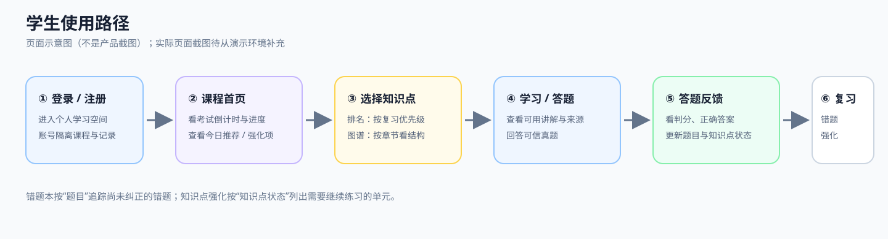

> 上图是帮助理解页面关系的示意图，不是产品截图。下面的页面导览配有本地 Demo 的真实界面截图；截图展示的是预置演示课程，不代表已部署的线上服务。

### 页面导览

#### 登录与注册

登录后进入个人学习空间，服务端按当前用户读取课程和学习记录。本组截图从已登录后的课程使用流程开始；登录、注册页面暂不放截图。

| 页面 | 这个页面代表什么 | 学生可以怎么用 |
| --- | --- | --- |
| 登录 / 注册 | 个人学习空间入口。账号登录后，服务端按当前用户读取课程和学习记录。 | 注册自己的用户名和密码，或登录已有账号。预置演示账号进入的是已经准备好的演示课程。 |
| 课程列表 / 新建课程 | 选择一门正在备考的课程，或创建新课程。 | 选择课程进入首页；新课程先填写课程信息，再上传资料。 |
| 课程首页 | 这门课的学习驾驶舱：考试日期、整体进度、今日推荐、可执行的下一步、知识点强化和资料入口都从这里进入。 | 先看推荐理由和真题证据摘要；再决定开始推荐内容，或自己进入排名、图谱、错题本。答题返回后，页面会重新读取课程数据。 |
| 知识点排名 | 按后端验证过的考试相关性展示知识点顺序；演示课程可以切换“真题重点”和“全部知识”。 | 考前先看真题重点；想系统补知识时切换到全部知识。排名是相对复习优先级，不是“考题概率”或考试保证。没有可练题时，先查看知识点资料，不要把它误解成练习入口失效。 |
| 知识图谱 | 按章节和父子关系浏览课程知识结构。它用于看知识之间的组织关系，不是按紧急程度排序的待办清单。 | 先定位章节，再打开具体知识点；复习先后可参考课程首页推荐和知识点排名。 |
| 知识点学习页 | 某个 StudyUnit 的学习入口，展示学习说明、证据状态、练习可用性，以及开始或恢复学习的操作。 | 阅读有来源支持的讲解，再开始练习；如果页面提示暂无可练题，表示当前没有通过检查并绑定到该知识点的题目。 |
| 学习 Session / 答题页 | 一次具体学习过程。Session 负责恢复当前学习状态、获取下一道题和提交答案。部分学习模式先展示讲解，题目优先模式则直接开始答题。 | 选择答案或输入答案后提交，按页面反馈继续下一题；完成后回课程页查看更新后的状态。 |
| 答题反馈 | 当前题目的判分结果与下一步信息。 | 对照自己的答案、正确答案和可用解析；解析或来源不足时，界面会如实显示限制，不应把正确答案本身当作完整讲解。 |
| 错题本 | **题目级**复习清单，关注具体哪道题还没答对。 | 查看自己的最近答案、正确答案和可用解析，可直接重做原题。最新一次答对后，该题会从“未解决错题”中移除。 |
| 知识点强化 | **知识点级**复习清单，关注哪些 StudyUnit 的整体练习状态仍需加强。 | 按知识点和近期表现进入强化。它和错题本不是同一个列表：一个列知识点，一个列具体题目。 |
| 资料管理 / 课程设置 | 管理课程材料、课程信息和考试日期。 | 上传支持的材料并观察处理状态；设置考试日期后，课程推荐会据此进入相应备考阶段。 |

### 推荐、排名和状态分别表示什么

**知识点排名**和**课程首页推荐**不是一回事。排名页展示一个有顺序的知识集合；首页推荐则从当前可行动的知识点中挑一个下一步。演示课程的考试相关性来自已准备的图谱 / 排名数据；学生答题会改变个人练习状态，但不会凭一次答题重新计算考试频率或改写冻结排名。

首页推荐会结合课程考试日期、知识点是否有真实考试证据、是否存在可信可练题、学生当前 mastery / coverage 状态，以及演示课程已有的排名顺序。课程接近考试时，策略会变化：较早阶段优先处理未掌握的真题重点；约 3–4 天时更重视尚未覆盖的真题重点；最后 2 天优先处理可练且较弱 / 需要复习的真题重点。该选择是确定性的规则，不是 LLM 实时判断，也不是考试命中概率。

在当前学生模型中，coverage 与 mastery 使用可信题集计算：对绑定到知识点且通过 Trust Gate 的题目，coverage 看每道题是否至少做过一次；mastery 使用每道题最近一次作答结果计算。全部可信题都至少做过一次且 mastery 达到 80%，才满足 MASTERED 条件。单纯打开知识点不等于覆盖；题目数量不同的知识点也按各自的可信题集计算。

**错题本的标准：** 按“题目 + 知识点”分组，只显示最近一次作答仍然错误的可信题；同一道题后来答对，就不再列为未解决错题。

**知识点强化的标准：** 按知识点的 mastery 状态筛选 `WEAK`、`REVIEW`、`LEARNING`，显示知识点级状态和近期准确率。它不是简单把错题本里的题换个页面重放。

### 实际界面截图

以下截图来自本地 Demo，统一裁剪为 **620 × 1080**，展示从课程总览、推荐、知识点浏览，到答题反馈与个人课程管理的实际页面。课程与题目是预先准备的演示内容。

| 图 1：课程首页与今日推荐 | 图 2：首页下一步与真题重点 |
| --- | --- |
| 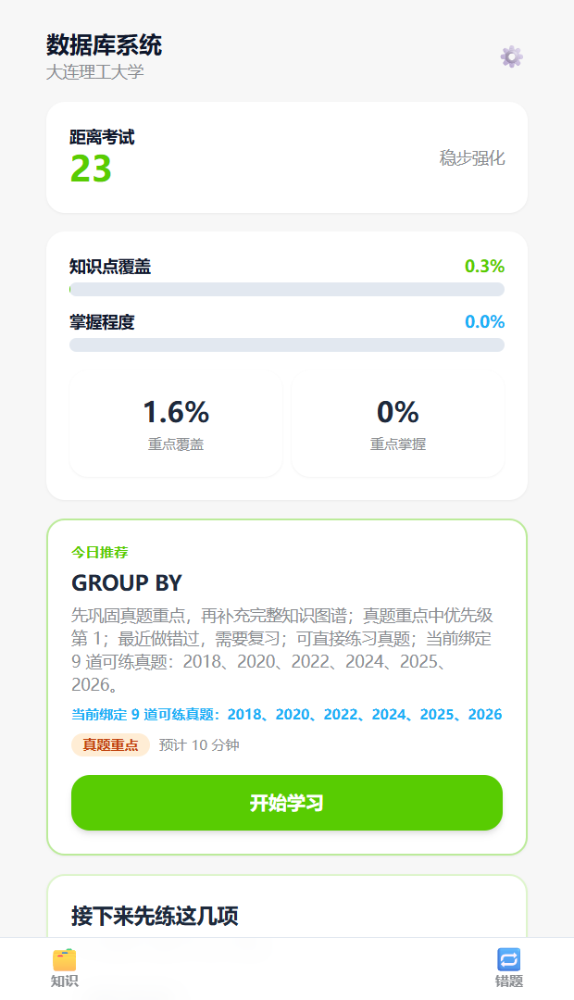 | 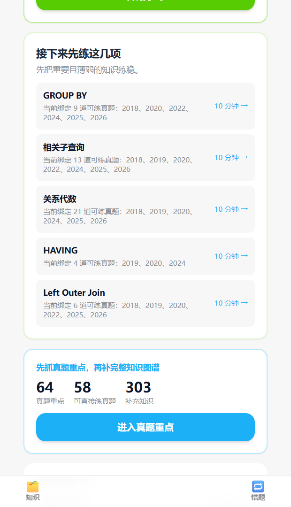 |

| 图 3：首页快捷入口 | 图 4：知识点排名（真题重点） |
| --- | --- |
| 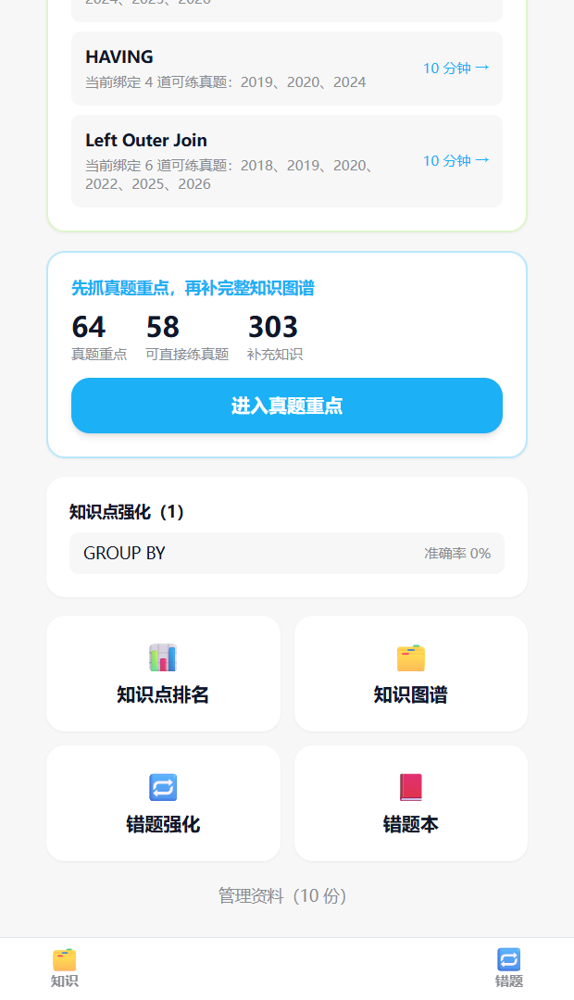 | 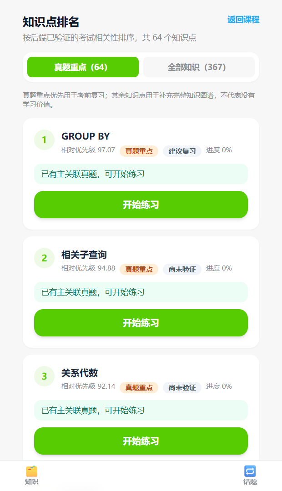 |

| 图 5：学习 Session 答题页 | 图 6：答题反馈与后续操作 |
| --- | --- |
| 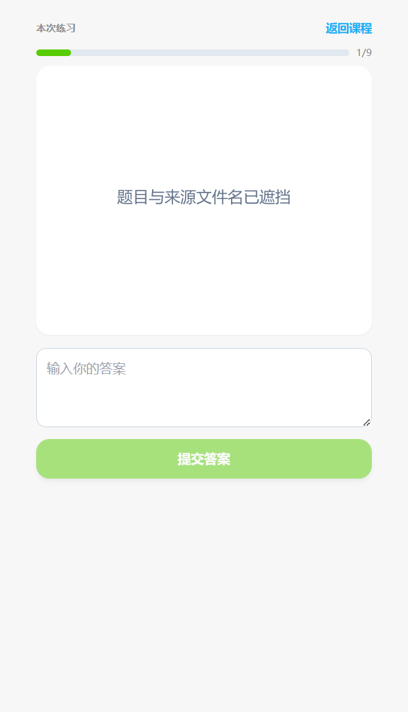 | 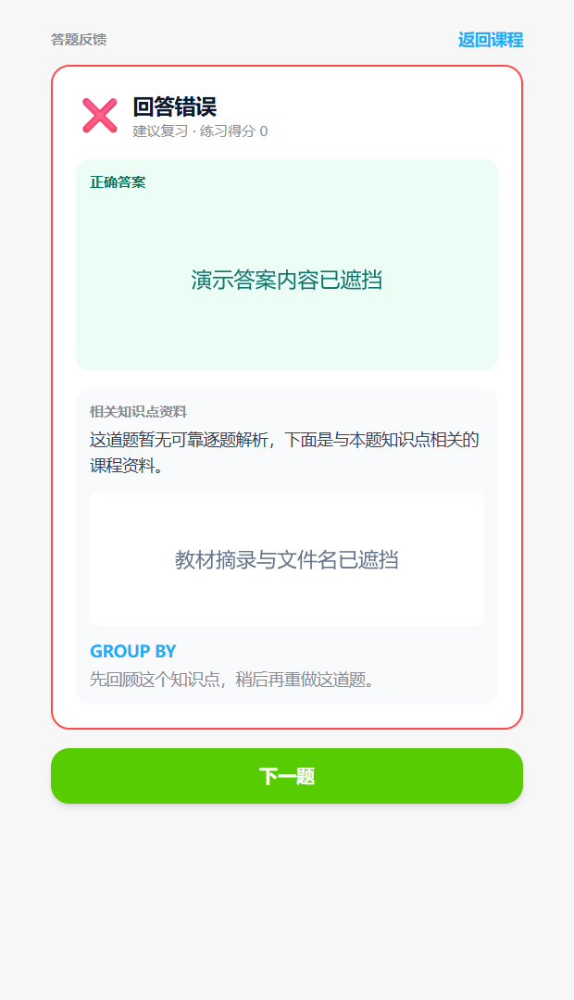 |

| 图 7：知识点强化 | 图 8：知识图谱 |
| --- | --- |
| 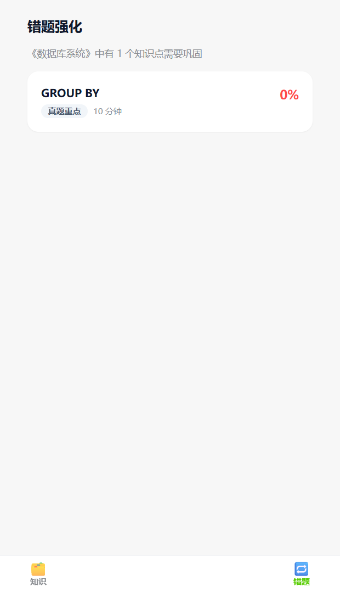 | 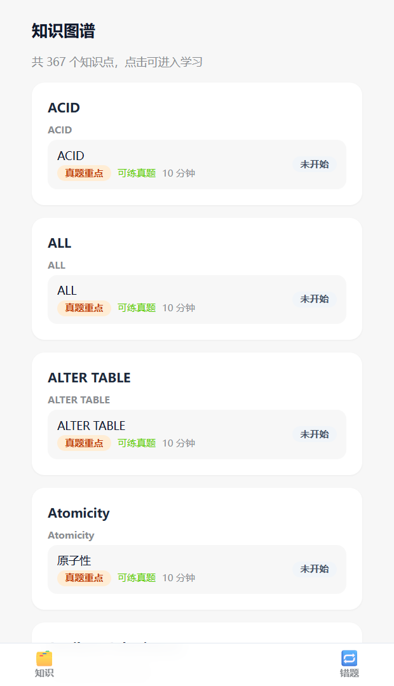 |

| 图 9：知识点排名（全部知识） | 图 10：新建课程 |
| --- | --- |
| 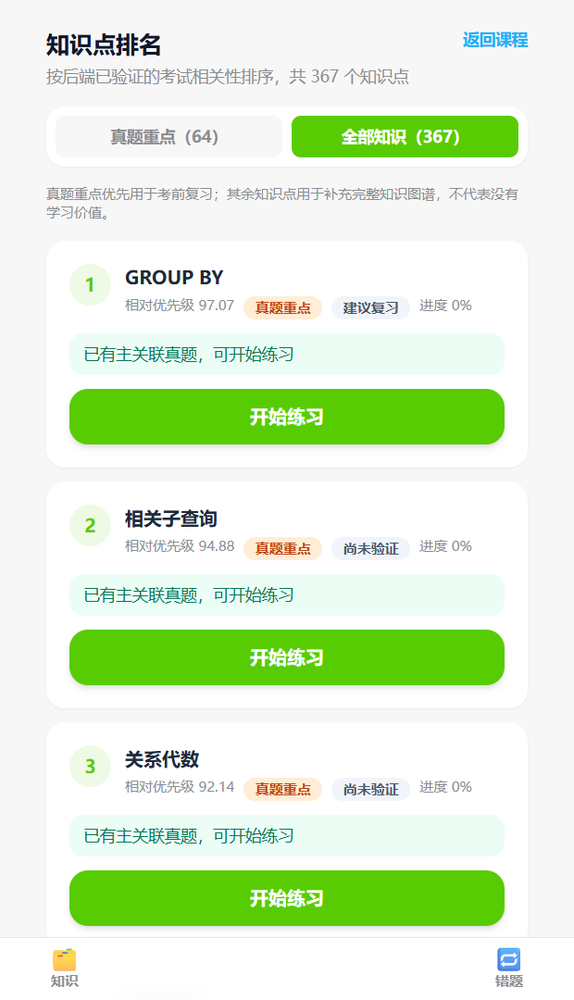 | 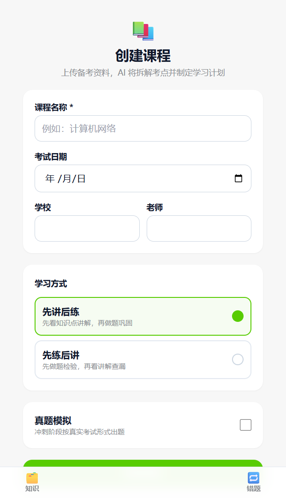 |

| 图 11：我的学习 |
| --- |
| 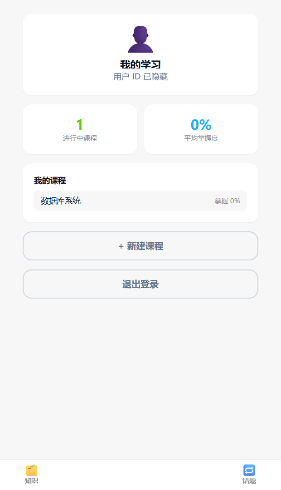 |

**从推荐到反馈的操作关系：** 先在图 1 查看考试日期、课程进度和今日推荐；图 2、图 3 展示首页提供的后续复习入口。进入真题重点后可从图 4 选择知识点并开始学习，图 5 是 Session 中的答题页面，学生在输入框填写答案后提交。后端判分后，前端展示图 6 的答题结果、相关知识点资料和“下一题”入口；若没有可靠的逐题解析，页面会明确说明，不会把正确答案伪装成解析。随后可在图 7 查看知识点级强化清单，或用图 8 浏览知识结构；图 9 展示完整知识列表，图 10、图 11 分别对应新建课程和个人课程概览。

本组截图未覆盖登录 / 注册、资料管理、课程设置、错题本和 Session 完成页，这些页面仍由上方页面导览说明。为避免公开真实考试材料，图 5 的题干与来源文件名、图 6 的答案与教材摘录，以及图 11 的用户 ID 均已遮挡。截图仅说明产品界面，不代表教材或考试题目获准公开。

## 系统技术地图

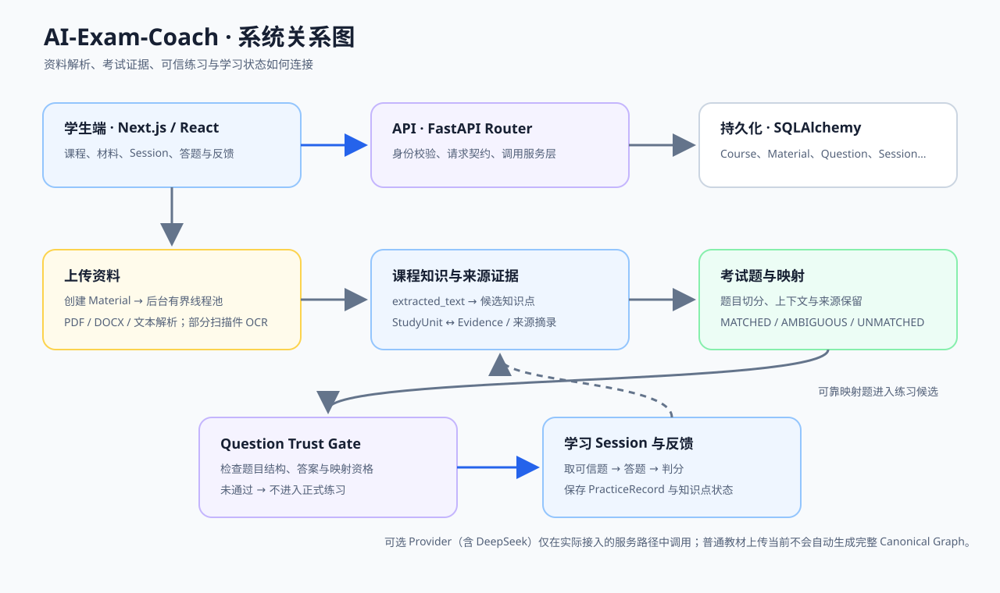

```text
浏览器（Next.js / React）
  │ 课程、资料、学习 Session、答题请求
  ▼
FastAPI Router
  ▼
Service 层 ─────────────── SQLAlchemy ─────────────── SQLite / PostgreSQL
  │                              │
  ├─ Material Worker             ├─ Course / Material
  │    └─ Parser / OCR            ├─ StudyUnit / Evidence
  │         └─ extracted_text     ├─ Question / ExamEvidence
  │                              └─ Session / PracticeRecord
  ├─ Course Brain / Exam Intelligence
  │    └─ 知识点候选、考试题切分、映射与证据
  ├─ Question Trust Gate
  │    └─ 决定题目能否进入练习
  └─ Student Learning Model
       └─ 解释投影、练习状态与学习反馈
```

### 两条资料处理路径

```text
教材 / 课堂资料
→ 上传并创建 Material
→ 后台 Worker 解析文件
→ 保存 Material.extracted_text
→ 课程级知识库从已保存文本中提取候选并关联来源证据
```

```text
历年真题
→ 解析并读取 extracted_text
→ 切分 Question，保留来源与上下文
→ 质量检查
→ 只对符合条件的题目尝试关联已有知识点
→ 保存映射状态和考试证据
```

两条路径有意分开：真题是考试证据，不应因为出现在试卷里就自动变成课程知识点；无法可靠关联的题目保留为未匹配，而不是硬塞给某个知识点。

## 核心技术设计

### 1. 文件处理不阻塞上传请求

上传请求负责保存文件并创建 Material。后续由后台 Worker 使用独立数据库 Session 处理材料，解析结果写入 `Material.extracted_text`。解析器记录文件哈希和 Parser 版本；文件未变化且已有有效结果时可以复用缓存。课程级处理在一批文件完成后统一执行，避免每个文件都重复触发课程评分。

**解决的问题：** 大文件解析或 OCR 不必占住用户的上传请求；缓存也减少对同一文件的重复解析。

**当前范围：** Worker 使用进程内有界线程池，适合本地 MVP；它不是跨多台服务器的持久化任务队列。解析器支持范围以当前代码为准，PPT/PPTX 尚未实现。

### 2. 来源证据与知识点一起保存

知识点不是只保存一个标题。材料来源的摘录、位置等信息会与 StudyUnit / Evidence 关联；解释投影会按证据类型决定展示教材解释证据、仅结构证据，或明确说明没有可用来源。

**解决的问题：** 学生和开发者可以追问“这个知识点或说明依据哪份资料”，也能区分真正的解释内容与仅能定位章节的结构信息。

### 3. 考试题映射允许拒绝猜测

Exam Intelligence 对题目进行切分、来源保留和质量判断，再从已有 StudyUnit 中寻找候选映射。映射可以是 `MATCHED`、`AMBIGUOUS` 或 `UNMATCHED`；低置信度结果不会被强行指定给某个知识点。

**解决的问题：** 错误映射会污染知识点的考试频率、推荐和后续练习，因此系统把“暂不确定”作为有效结果保存。

### 4. Trust Gate 是练习入口，不是题目生成器

练习服务在返回题目和提交答案时都会检查题目是否满足可信条件，例如答案、选项、题目结构和映射资格。未通过时不会伪装成可靠真题继续练习。

**解决的问题：** 宁可说明当前没有可靠练习题，也不把缺失选项、错误答案或来源不明的内容交给学生。

### 5. 答题结果回到学生学习模型

前端通过 API 启动学习 Session、获取下一题并提交答案；后端保存 PracticeRecord，计算答题反馈和知识点状态，再由课程页面重新读取学习数据。

```text
课程 / 知识点页面
→ 创建或恢复 Session
→ 获取可信题目
→ 提交答案
→ 判分并保存 PracticeRecord
→ 更新知识点学习状态
→ 前端展示反馈与后续动作
```

**解决的问题：** 练习不是孤立的一次请求，结果会用于错题回看、知识点状态和后续学习流程。

## AI 能力与当前边界

项目的核心方向是用 AI 帮助理解课程材料，并在来源证据约束下整理知识点和考试内容。代码中包含 Provider 抽象、本地 Heuristic Provider，以及可配置的 OpenAI-compatible / DeepSeek 接入；另有受约束的语义候选提取能力。

需要准确区分“有 Provider 代码”和“普通教材上传会调用 Provider”：**当前普通教学材料的默认运行链路不会调用 DeepSeek 来自动生成通用 Canonical Graph。** 教学材料解析后，课程级知识库构建从已持久化的文本中提取候选；预置演示课程的 Canonical Graph 和真题关联则来自已准备的数据。因而，不能把当前版本描述成“任意上传教材后，AI 自动生成完整知识图谱并匹配真题”。

| 能力 | 当前状态 |
| --- | --- |
| 后端 Provider 抽象与本地启发式处理 | 已实现 |
| OpenAI-compatible / DeepSeek 配置入口 | 已实现；是否被调用取决于具体服务路径和配置 |
| PDF / DOCX / TXT / Markdown 文本提取 | 已实现；扫描型 PDF / DOCX 可尝试 OCR |
| 普通新教材自动生成高质量通用 Canonical Graph | 尚未完整打通 |
| 预置演示课程的知识图谱与真题练习 | 使用已准备的数据，可用于稳定演示 |
| 不可靠题目自动进入练习 | 不允许；由后端 Trust Gate 拦截 |

配置 DeepSeek 不等于所有上传任务都会使用 DeepSeek。Provider 密钥只在后端读取；若未来把语义识别接入普通教材链路，还需要候选结构校验、证据位置核验、质量门槛和失败回退，不能直接把模型输出当成已发布知识点。

**当前可以这样理解两条路径：**

1. **普通新课程：** 上传材料 → 后台解析并保存文本 → 从文本提取教学候选。完整、通用的 AI 知识点识别、Canonical Graph 发布和真题自动关联尚未形成默认运行闭环。
2. **预置演示课程：** 使用事先准备好的知识图谱、题目和考试证据 → 学生可体验排名、可信题目练习、答题反馈和状态更新。学习记录会随账号保存在数据库中；这不表示每次上传都会重新生成这些冻结数据。

这一区分是当前版本的能力边界，不是线上 AI 处理效果或模型准确率的承诺。当前 README 不提供未经测量的准确率、成本或模型质量指标。

## 技术栈

| 层 | 技术 |
| --- | --- |
| Web | Next.js、React、TypeScript、Tailwind CSS |
| API | Python、FastAPI、Pydantic、SQLAlchemy |
| 数据库 | SQLite 本地开发；支持配置 PostgreSQL |
| 材料处理 | PDF / DOCX / 文本解析；扫描材料 OCR |
| AI 接入 | Provider 抽象、本地 Heuristic、OpenAI-compatible / DeepSeek |
| 测试 | pytest、TypeScript、Node Test Runner、React Testing Library |

## 本地运行

本地启动分为**应用代码**和**演示数据**两件事：代码可以从仓库安装运行；完整预置演示课程的数据不会随仓库公开。不要把本机 `.env`、数据库或上传材料复制到公开仓库。

### 1. 准备环境

```powershell
git clone https://github.com/Soulwon06/AI-Exam-Coach.git
cd AI-Exam-Coach
Copy-Item .env.example .env
```

按 `.env.example` 配置本地数据库、前后端地址和可选认证设置。不要提交 `.env`、数据库文件、上传资料或任何 API Key。新建的本地数据库首次启动后，请注册账号、创建课程并上传自己有权使用的材料。

仓库中的 `python -m app.seed` 是**开发用小样例**：它会创建一门计算机网络示例课程和文本材料，供检查基础材料处理流程；它不是预置的“数据库系统”完整演示库，也不保证生成可完成整套真题练习的题库。需要体验完整冻结课程时，必须另行准备该课程数据和本地账号配置；仓库不会提供账号密码或课程数据库。

### 2. 启动后端

```powershell
Set-Location backend
python -m pip install -r requirements.txt
python -m uvicorn app.main:app --reload --host 127.0.0.1 --port 8000
```

### 3. 启动前端

另开终端：

```powershell
Set-Location frontend
npm ci
npm run dev
```

访问 <http://localhost:3000>。本地 API 健康检查：<http://127.0.0.1:8000/api/v1/health>。

### 可选：配置 DeepSeek

在后端 `.env` 中配置 OpenAI-compatible Provider。密钥只保存在服务端环境变量中，不要使用 `NEXT_PUBLIC_` 前缀：

```dotenv
AEC_AI_PROVIDER=openai_compatible
AEC_OPENAI_BASE_URL=https://api.deepseek.com/v1
AEC_OPENAI_MODEL=deepseek-chat
AEC_OPENAI_API_KEY=替换为本机密钥
```

此配置仅启用 Provider 的可用性；是否实际调用仍由对应的服务流程决定，当前普通教材处理链路不会因为设置了密钥就自动变为完整 AI 知识图谱流水线。

## 验证与测试

```powershell
# 后端
Set-Location backend
python -m pytest

# 前端
Set-Location frontend
npm test
npx tsc --noEmit
npm run build
```

## 安全与部署说明

- 注册用户使用独立账号；业务数据由服务端会话身份关联，不以浏览器自报用户 ID 作为认证依据。
- 密码以哈希保存，会话使用 HttpOnly Cookie。
- AI API Key 只由后端读取；不要把密钥放进前端环境变量或公开提交。
- 上传材料和本地数据库可能包含个人或课程资料，不应随代码公开。
- 当前 README 描述的是可本地运行的项目版本，不代表已提供托管 SaaS、邮件验证、找回密码或完整公网运营能力。公网部署前还应完成生产级会话、限流、备份、监控和文件存储配置。
- 不要把真实学生数据、可识别个人信息、未经授权的教材或真题放进截图、示例数据库、测试夹具或公开提交。

## 项目状态

当前版本重点展示课程资料处理、课程知识点与考试证据组织、可信真题练习、答题反馈和账号数据隔离。预置课程用于完整体验已准备好的学习闭环；任意新教材的通用 AI 知识点识别与 Canonical Graph 发布仍是后续建设方向。

README 当前收录 11 张本地 Demo 界面截图，以及学生使用路径图和系统关系图；其中包含答题页和答题反馈页。题干、正确答案、教材摘录、来源文件名和用户 ID 已遮挡，截图不包含账号密码或 API 密钥。登录 / 注册、资料管理、课程设置、错题本和 Session 完成页以文字说明为主，本组截图未覆盖这些页面。

**公开发布前建议逐项确认：**

- 在干净副本中按本 README 从头安装、启动并验证注册、建课和基础材料处理；区分基础样例与冻结演示库。
- 重新检查所有截图、测试数据和仓库文件，确认没有密码、Token、个人信息、私有数据库或未获公开授权的课程材料 / 真题。
- 确认代码、截图及随仓库分发的第三方材料授权后，再选择并添加适用的 License；当前仓库不应被误读为已经授予任意复制、修改或再分发许可。
- 若未来提供公网 Demo，再补充真实访问链接、可用账号说明、数据重置策略和服务状态；在此之前不要用本地截图暗示线上服务可用。

## 项目文档

- [用户流程](docs/03_USER_FLOW.md)
- [Course Brain](docs/04_COURSE_BRAIN.md)
- [评分引擎](docs/05_SCORING_ENGINE.md)
- [数据库结构](docs/07_DATABASE_SCHEMA.md)
- [AI Pipeline](docs/08_AI_PIPELINE.md)
- [API 契约](docs/10_API_CONTRACT.md)

## License

当前尚未附加 License。公开发布前，请先确认代码、课程资料、题目、截图和第三方依赖相关素材的授权，再决定是否以及采用何种许可。没有明确公开授权的教材或真题内容不要随仓库公开。
